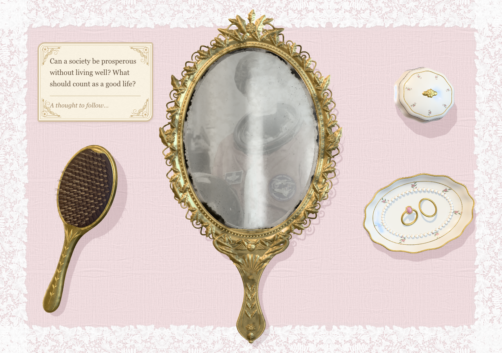
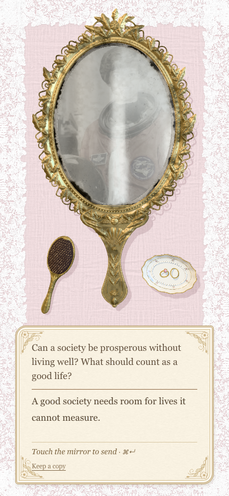
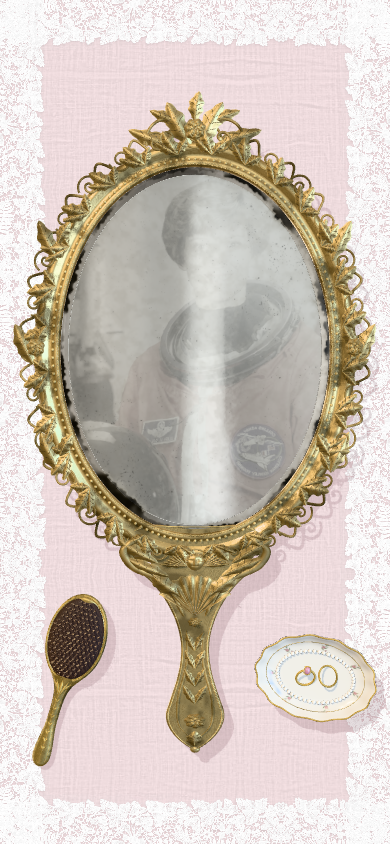

# Reflection

Reflection is a Victorian camera mirror that uses facial expression cues processed on your device to offer philosophical writing prompts and lets you send your responses into the glass.

  
  

